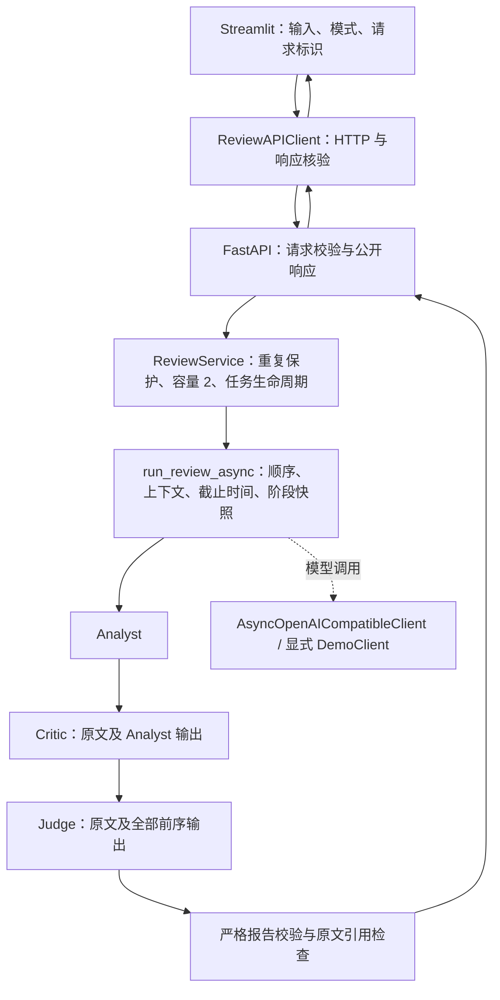

# 工程实施状态

更新：2026-10-17。历史实施记录中的“当前”以各自编写日期为准；专题与源码手册按现有代码讲解；本表汇总现行实现与实际验证，不替代个人学习验收。

| 里程碑 | 当前状态 | 证据与剩余项 |
| --- | --- | --- |
| D1 调用链 | 历史基线完成 | [D1](../archive/engineering/week-01-evidence.md)：原同步实现与 60 项测试 |
| D2 数据契约 | 完成 | [D2](../archive/engineering/day-02-evidence.md)：模式、严格 Judge JSON、引用和阶段记录 |
| D3 异步与取消 | 完成 | [D3](../archive/engineering/day-03-evidence.md)：单一异步内核、三层超时、并发隔离、取消与资源回收 |
| D4 本地 API | 完成 | [D4](../archive/engineering/day-04-evidence.md)：严格 HTTP 契约、容量、活动标识和生命周期 |
| D5 UI 与 live | UI/fake 验收完成；live 待验证 | [D5](../archive/engineering/day-05-evidence.md)：本机无 Qwen/DeepSeek 凭据，未执行真实调用 |
| D6 自动回归 | 本地检查与日志完成；远程 CI 待核验 | [D6](../archive/engineering/day-06-evidence.md)：交付包含 GitHub Actions 配置，远程结果以对应提交的 Actions 记录为准 |
| D7 复现 | Linux/Python 3.12 离线范围完成 | [D7](../archive/engineering/day-07-evidence.md)：两份干净环境、精确依赖、本机链路和进程重启；live、远程 Git 检出验收待补 |

最新默认回归 **343 项**；课堂回归 **7 项**；HTTP 练习参考实现 **29 项**。学习练习的 TODO 版本有意保留，不作为通过实现。未引入数据库、Docker、自动重试、后台队列或持久化历史。

2026-10-17 审查修订：请求名额登记后立即进入 `try/finally`，覆盖首条事件记录失败或取消时的清理；同步教学客户端及练习参考答案的超时错误码统一为 `network_timeout`。补充报告契约同步维护与配置校验边界的说明。以上修订已通过本地统一检查，尚未提交或上传。

## 现在一次审核怎样执行

UI 等待一次 HTTP 请求完成后展示全部有效回答。API 完成不等于 Judge 赞成方案；有效的“需要修改”或“证据不足”报告也返回 201。失败时保留本次有效部分结果，最终报告为空。模型调用、HTTP 层、服务准入和展示各有自己的职责。

## 为什么保留这些边界

- **客户端负责通信。** 模型客户端处理供应商请求与响应，UI 客户端处理本地审核 API。工作流不需要知道 HTTP 状态码；页面不直接调用供应商。
- **契约负责数据。** 原文保持原样，引用使用 Python 字符切片校验。仅有合法 JSON 不等于合法审核报告；字段、范围、枚举与结论一致性都要检查。
- **工作流负责依赖。** 一份审核仍是 A → C → J；并发发生在互不依赖的审核之间。只有一份异步编排，Python 同步调用入口只做适配。
- **Service 负责资源。** 一次不可中断的准入登记防止同循环中的竞争；任务结束后释放自己取得的标识，拒绝请求不能释放他人的名额。
- **资源所有者负责关闭。** 单份模型调用不关闭应用共享客户端；服务退出先收拢审核，再关闭传输，避免影响其他审核。

这些是可检查的设计依据。读代码时按“输入契约 → 谁拥有状态 → 失败时保留什么 → 谁清理资源”追踪，比只记住类名更有用。

## 学习入口

个人学习从 [阶段路线](../../study/学习路线.md) 和 [学习进度](../../study/今天.md) 开始。HTTP 在阶段 8 按需进入；本页的历史 D1—D7 是工程记录编号，不对应个人学习阶段或完成天数。

## 后续路线：先补验收，再按需求扩展

下表为后续安排，尚未新增对应功能或验收证据；不把它们计入 D1—D4 学习完成条件。

| 顺序 | 工作 | 验收依据 |
| --- | --- | --- |
| 1 | 真实 Qwen/DeepSeek 联调与固定样例质量评估 | 实际连通性、Judge 合法报告率、误报/漏报、建议依据、耗时与费用；分别记录执行与质量 |
| 2 | 远程 CI 与 Git 干净检出交付验证 | 实际远程检查结果、从明确提交检出并安装运行的证据 |
| 3（按需） | 最小本地 RAG | 资料加载、切片与检索，证据上下文、来源引用、检索无结果与失败处理；评估命中与结论依据 |
| 4（按需） | 采用 LangChain 组件 | 确有集成需求时复用模型/文档/检索组件，保留现有顺序、契约和失败语义，并运行回归 |

RAG 可先使用本地文件与内存检索，不需要违反当前不引入数据库或 Docker 的约束。加入资料后需明确区分“用户原文引用”和“知识库证据引用”，扩展数据契约、三角色上下文与 UI 来源展示，不能只把检索文本拼进提示词就宣称事实核验完成。

LangChain 是可选实现工具，不是 RAG 的前置条件，也不是三角色架构的必需依赖。当前 logic/evidence 仍只使用输入材料，待正式扩展后再更新能力描述与测试。

## 文档维护范围

阶段路线负责学习顺序，专题和手册解释现有代码；个人进度按实际学习证据记录。历史实施记录保留原日期、测试数量和当时接口，顶部链接回本总览。Word/PDF 旧导出的版本说明见 [历史档案](../archive/README.md)。
