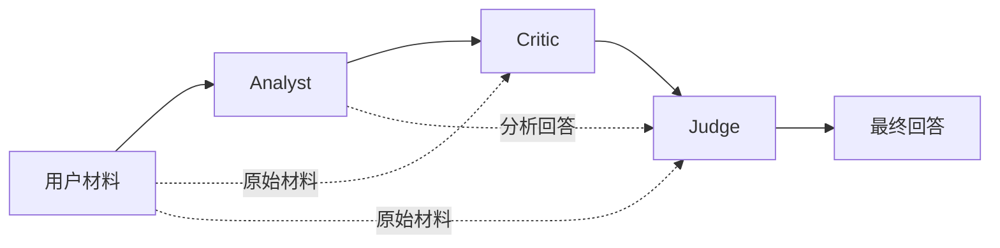

# 源码详解

按主题查阅，不规定学完时长。首次学习只打开 [阶段路线](../../study/学习路线.md) 指定的小节，当前起点见 [学习进度](../../study/今天.md)。

本手册合并原“从零教程”与“源码精读课程”的源码定位、概念解释和练习。重复的安装说明、概念和自测不再另设一条课程路线。示例与答案保留在 `examples/core/`，不是首次学习必读清单。

修订：2026-10-17。本文按现有异步内核与 HTTP 服务解释工程；入门阶段用简化例子建立理解，再逐项对照这些边界。安装启动查 [运行说明](../../README.md)，语法卡点查 Python 用法速查（基础资料：`~/ai-engineering/learning/python/语法与用法.md`），专题细节按阶段路线选读。工程状态见 [实施总览](工程状态.md)。

## 目录

1. [先把项目要解决的问题说清楚](#s01)
2. [分清开发时的 AI 和运行时的 AI](#s02)
3. [够用的 Python 与工程术语](#s03)
4. [准备环境，先跑检查](#s04)
5. [不花 API 费用，先跑通三阶段](#s05)
6. [配置后端与首次运行](#s06)
7. [读懂并练习角色定义](#s07)
8. [读懂配置与验证](#s08)
9. [读懂环境加载](#s09)
10. [读懂模型客户端](#s10)
11. [读懂契约与异步工作流](#s11)
12. [追踪成功、失败与取消](#s12)
13. [读懂 UI、HTTP 与会话状态](#s13)
14. [用测试证明行为](#s14)
15. [按边界排错](#s15)
16. [与开发工具协作的流程与指令](#s16)
17. [用审查案例判断建议](#s17)
18. [Git、环境文件和学习原型](#s18)
19. [动手练习、验收与后续路线](#s19)
20. [源码索引与文档维护](#s20)

<a id="s01"></a>

## 1. 先把项目要解决的问题说清楚

用户输入文本、代码、推理或技术方案，程序依次请 Analyst、Critic、Judge 评审，并展示每个阶段与最终报告。角色独立系统提示词、原文及前序输出的传递由程序保证，内容是否准确要另行评估。

| 要求 | 可验收行为 |
| --- | --- |
| 角色与顺序 | 三个独立 system prompt；A 完成后才启动 C，再启动 J |
| 上下文 | 每轮有原文与模式，C 增加 A，J 增加 A 与 C |
| 模型可配置 | 后端环境变量选择供应商、端点、模型与预算，Key 不硬编码 |
| 业务与网络分开 | fake 客户端也运行同一个异步内核 |
| 报告有效 | Judge JSON、字段、引用和跨字段规则全部通过才发布报告 |
| 展示过程 | HTTP 返回后显示所有有效角色回答、阶段状态与报告 |
| 失败可见 | 后续角色停止，保留有效部分结果，最终报告为空 |
| 输入限制 | 非空白，最多 20,000 Python 字符，保留原文 |
| 资源有边界 | 单 worker 服务容量 2，满载拒绝，任务退出释放本次占用 |
| 会话恢复 | 页面普通重跑恢复已收到的结果，不重发审核 |

当前没有数据库、Docker、持久化幂等、历史查询、自动重试、RAG 或自主工具调用。logic/evidence 都只评估所给材料。学习时要能指出每条行为由哪个函数与断言保证。


<a id="s02"></a>

## 2. 分清开发时的 AI 和运行时的 AI

本项目涉及两种不同的 AI 使用方式。

| 场景 | AI 接收什么 | AI 产出什么 | 谁实际运行代码 |
| --- | --- | --- | --- |
| 开发项目时 | 需求、源码、报错和测试结果 | 解释、修改建议、代码或审查报告 | 你或具有执行能力的开发工具 |
| 使用项目时 | 用户材料、角色提示词和前序回答 | 三个角色的回答与 Judge 报告 | 本地 Python 程序负责请求与展示 |

在聊天窗口让 AI 写代码，不会自动使你的 Python 程序接入模型。程序仍需要 API 地址、API key、请求格式和响应解析。

这里的一个 Agent 在代码中只是一个包含 `name` 和 `system_prompt` 的对象。三个 Agent 由同一个顺序循环调度。它们没有自己的常驻线程，没有工具调用，也没有跨任务的记忆。

三个角色可以使用同一个模型。所谓“独立角色”指的是各自的提示词与请求上下文，不能据此推断它们有完全独立的判断能力。



正常完成一次审查会发送三次模型请求。后续请求包含更长上下文，耗时和费用通常都会增加；具体计费取决于提供商和模型，本项目没有计算费用或保存 token 用量。

你可以把本项目理解成一个组织三轮评审的程序。程序保证“材料交给谁、按什么顺序交、失败时怎么处理”；模型负责生成评审内容。

<a id="s03"></a>

## 3. 够用的 Python 与工程术语

### 3.1 先看懂这些词

| 术语 | 在这里的意思 | 对应位置 |
| --- | --- | --- |
| 模块 | 一个可以导入的 Python 文件 | `config.py` |
| 包 | 组织相关模块的目录 | `review_system/` |
| 依赖 | 项目需要安装的第三方库 | Streamlit、HTTPX、FastAPI、Pydantic、python-dotenv |
| 虚拟环境 | 为项目准备独立的 Python 与依赖目录 | `.venv/` |
| 环境变量 | 进程运行时读取的外部配置 | `REVIEW_PROVIDER` |
| API | 程序向外部服务请求能力的接口 | 模型聊天接口 |
| HTTP POST | 把请求数据发送到服务器的一种方法 | `clients.py` |
| JSON | 用文本表达字典、列表等数据的格式 | 请求体与角色上下文 |
| 回调 | 把一个函数交给另一个函数，在约定时机执行 | `on_response` |
| 异常 | 当前操作无法正常完成时的错误对象 | `LLMError` |
| mock | 在测试中替换真实对象或操作的替身 | AsyncMock 或 mock transport |
| 回归测试 | 修复问题后，防止同类问题再次出现的测试 | 断流与回调失败测试 |

### 3.2 源码中的语法对照

下面是阅读说明，代码片段不是完整模块。

```python
def complete(self, *, model: str, messages: list[dict[str, str]]) -> str:
    ...
```

- `self` 是当前对象，例如某个客户端实例。
- `*` 后的参数必须按名字传入，因此写 `complete(model="m", messages=[])`。
- `model: str` 表示预期模型名是字符串。
- `list[dict[str, str]]` 表示消息是一个列表，每项是字符串键与字符串值的字典。
- `-> str` 表示预期返回字符串。
- 类型标注主要帮助阅读与静态检查，Python 不会仅因为写了标注就自动验证所有运行时参数。

```python
@dataclass(frozen=True)
class AgentResponse:
    agent: str
    model: str
    content: str
```

`dataclass` 为这种“主要存数据”的类生成初始化等方法。`frozen=True` 限制实例字段被重新赋值；它不是对任意嵌套对象进行深层冻结。本项目的响应字段都是字符串，结果集合用元组保存。

```python
on_response: Callable[[AgentResponse], None] | None = None
```

意思是：可以传入一个接收 `AgentResponse`、不返回业务结果的函数，也可以不传。`| None` 表示允许为空。

```python
tuple[AgentResponse, ...]
```

表示元素都是 `AgentResponse` 的元组，元素个数不限。这里的 `...` 是类型标注的一部分。

```python
from .clients import AsyncLLMClient
```

`.` 表示同一个包中的模块。不要直接运行 `python review_system/workflow.py` 来启动项目；这容易使相对导入失去包上下文。应通过 `app.py` 或从项目根目录导入 `review_system.workflow`。

### 3.3 对象、导入与配置的进阶补充

完成阶段 6 后按需阅读，不作为入门前置。

### 导入、定义和调用分开看

首次通常导入模块时，Python 执行模块顶层代码，并在 `sys.modules` 缓存模块；后续通常导入复用缓存。`from ... import name` 将当时找到的对象绑定到导入方名称，源模块后来重新赋值，不会自动更新这个绑定。

执行 `def` 创建函数对象，通常不执行函数体；执行 `class` 会执行类体并创建类对象。对本项目的数据类调用 `Class(...)` 才创建实例。不要把定义类理解为“类体内的代码都不会执行”。

### 名称引用和配置快照

赋值绑定对象引用，浅复制只复制外层容器。[E01_objects.py](../../examples/core/E01_objects.py) 展示两个不同列表仍共享内部字典的情况。本项目结果用 `tuple`、响应对象用 `frozen dataclass`，限制外层修改与字段赋值；它们不会递归冻结任意嵌套对象。

`Settings.from_env()` 读取、清理、校验环境变量，再生成 live 后端启动时的配置快照。直接 Settings(...) 会执行 __post_init__ 的时间校验，但不会执行 from_env 中的供应商、凭据与 URL 校验；类型标注也不代替运行时检查。`api_key` 的 `repr=False` 仅隐藏常规对象表示中的字段，不是加密。

```text
environment.py：将项目 .env 加载到进程环境，override=False
config.py     ：读取进程环境 → 清理与校验 → Settings

通常优先级：已有进程值 → .env → 代码默认
```

已有进程值包括空字符串；阶段模型另有 `or model` 的空白回退。修改 `.env` 后，进程中原有值可能继续保留，应检查 shell 覆盖并重启实际读取配置的后端；UI 有自己的 APISettings。


### 3.4 终端与 Python 代码不是同一种输入

```bash
.venv/bin/python -m pytest
```

这是终端命令，不应放到 Python 的 `>>>` 提示符后执行。`-m pytest` 表示使用这个 Python 环境运行 pytest 模块。

```python
from review_system.workflow import run_review
```

这是 Python 代码，不是 Bash 命令。本文会为代码块标注 `bash`、`powershell`、`python` 等语言。

<a id="s04"></a>

## 4. 准备环境，先跑检查

### 4.1 确认项目根目录

终端当前目录应包含 app.py、pyproject.toml、review_system 和 docs；本工作区路径为 /home/fanli/ai-engineering/multi-agent/mvp。切换到实际检出的目录后执行：

```bash
pwd
.venv/bin/python --version
```

没有虚拟环境时按下一节创建；已有可用环境就跳过创建，避免混用其他项目解释器。

### 4.2 Linux / WSL 安装与验证

```bash
python3.12 -m venv .venv
.venv/bin/python -m pip install -r requirements-py312-linux.txt -e '.[test,dev]'
.venv/bin/python scripts/check.py
```

精确依赖是 Linux x86_64/Python 3.12 的已验证快照；安装需要包源。统一检查包含 Ruff、文档本地链接、默认 pytest、课堂测试、HTTP 练习参考实现和 pip check。它不调用真实模型，也不包含本机监听演示。

只跑默认业务回归使用 `.venv/bin/python -m pytest -q`；实际数量与耗时记录本次输出，不照抄历史 D1 的 60 项。

### 4.3 Windows PowerShell

Linux 精确清单未做 Windows 同等验证。原生 Windows 可按声明范围安装依赖；需先确保 Python 3.12 可用：

```powershell
py -3.12 -m venv .venv
.\.venv\Scripts\python.exe -m pip install -e '.[test,dev]'
.\.venv\Scripts\python.exe scripts/check.py
```

Bash 的行首环境变量、export、反斜线续行与 heredoc 不能直接粘贴到 PowerShell；PowerShell 使用 `$env:名称 = '值'`，解释器路径改为 `.\.venv\Scripts\python.exe`。项目源码相同，安装与平台行为以实际检查为准。


<a id="s05"></a>

## 5. 不花 API 费用，先跑通三阶段

先验证程序行为，再配置真实模型。现有成功与失败脚本直接调用业务内核，不启动 UI/API，不读取真实凭据：

```bash
PYTHONPATH=. .venv/bin/python examples/core/E05_project_trace.py
PYTHONPATH=. .venv/bin/python examples/core/E06_project_failure.py
```

E05 中 FakeClient 的 complete 是异步方法，按序返回 A、C 与合法 Judge JSON。打开 [脚本](../../examples/core/E05_project_trace.py)，定位 outputs、calls、run_review 与回调；修改仅限自己的练习副本。

| 角色 | 收到的上下文键 | 接受后有效回答 |
| --- | --- | --- |
| Analyst | original_input、review_mode | A |
| Critic | 再加 analyst_output | A、C |
| Judge | 再加 critic_output | A、C、Judge JSON |

成功输出中的 verdict=pass 是人工预置值，不证明材料合理。字面字符串 J 不满足最终报告契约；符号 J 只可用来指代完整合法 JSON。

E06 人为让 Critic 抛 LLMError，输出 `Critic 1`；脚本另断言调用为 2 次。数字 1 是有效回答数量，Judge 不启动。去掉 E05 的 on_response 仍能得到结果，只是不再逐阶段打印；这不改变当前 UI 在 HTTP 返回后统一展示的行为。


<a id="s06"></a>

## 6. 配置后端与首次运行

### 6.1 无凭据体验现有系统

终端一启动显式 fake 后端：

```bash
REVIEW_EXECUTION_MODE=fake .venv/bin/python -m uvicorn review_system.api:create_app --factory --host 127.0.0.1 --port 8000 --workers 1
```

终端二启动页面：

```bash
REVIEW_API_BASE_URL=http://127.0.0.1:8000 .venv/bin/python -m streamlit run app.py --server.address 127.0.0.1
```

打开终端给出的页面地址，提交一份材料，确认 fake 标识、三个回答、状态与报告。fake 固定结果只演示链路，不评价输入。按 Ctrl+C 分别停止服务。

### 6.2 live 配置只由后端使用

按 [运行说明的配置步骤](../../README.md#配置后端并启动-ui)在 .env 不存在时复制模板，并在本机编辑。不要覆盖已有配置，不把 Key 写进源码、学习记录或示例。

| 配置 | 用途 |
| --- | --- |
| REVIEW_EXECUTION_MODE | live 默认，fake 必须显式选择 |
| REVIEW_PROVIDER | qwen / deepseek |
| QWEN_API_KEY / DEEPSEEK_API_KEY | 对应供应商凭据 |
| 各供应商 BASE_URL / MODEL | 模型接口根地址与默认模型，默认值见 config.py |
| ANALYST_MODEL / CRITIC_MODEL / JUDGE_MODEL | 角色模型名覆盖，仍共用一个供应商和 Key |
| REVIEW_TIMEOUT_SECONDS | HTTPX 网络操作，默认 60 秒 |
| REVIEW_MODEL_TIMEOUT_SECONDS | 单次模型调用预算，默认 60 秒 |
| REVIEW_TOTAL_TIMEOUT_SECONDS | 整次审核预算，默认 150 秒 |
| REVIEW_API_BASE_URL / REVIEW_API_TIMEOUT_SECONDS | UI 的后端地址与 HTTP 等待配置 |

端点和模型默认值是代码配置，不保证你的账号、区域可用；按实际供应商支持范围配置，并通过 live 调用验证。不要为文档练习自动发出付费请求。

配置后启动 live 后端：

```bash
REVIEW_EXECUTION_MODE=live .venv/bin/python -m uvicorn review_system.api:create_app --factory --host 127.0.0.1 --port 8000 --workers 1
```

UI 启动方式与 fake 相同。只在 UI 环境改 REVIEW_PROVIDER，不会改变另一个已运行后端。修改 .env 后，已有进程环境优先；必要时清除对应 shell 覆盖并重启后端。

### 6.3 首次验收的证据

健康接口只证明服务存活；fake 全链路证明受控程序行为；真实供应商调用才证明当次连通性。审核质量还需固定样例、预期问题与人工评价。当前工程记录尚未完成 live 验收，详见实施总览。


<a id="s07"></a>

## 7. 读懂并练习角色定义：agents.py

[agents.py](../../review_system/agents.py) 只保存角色定义与提示词，没有网络和编排。最小形态如下，是概念片段，不是完整提示词副本：

```python
from dataclasses import dataclass

@dataclass(frozen=True)
class Agent:
    name: str
    system_prompt: str
```

实际 ANALYST、CRITIC、JUDGE 分别要求分析、独立质疑和裁决。共同模式说明要求只使用所给材料；Judge 还包含完整报告字段、枚举、引用坐标与样例。

动手验证：

```bash
.venv/bin/python - <<'PYCODE'
from review_system.agents import ANALYST, CRITIC, JUDGE
agents = (ANALYST, CRITIC, JUDGE)
assert [a.name for a in agents] == ['Analyst', 'Critic', 'Judge']
assert len({a.system_prompt for a in agents}) == 3
print('三个独立角色提示词已定位')
PYCODE
```

这检查不同文本，不证明模型判断真正独立。练习是在副本中改写一个角色职责，并先说明希望哪个样例的哪类问题被发现；不要因提示词更长就断言质量提高。


<a id="s08"></a>

## 8. 读懂配置与验证：config.py

[config.py](../../review_system/config.py) 的 Settings 是不可变配置对象，from_env 读取环境并校验，api_key 设置 repr=False，常规对象表示不会展示该字段；这不是加密。

读代码按以下顺序：供应商枚举 → 对应 Key → 根地址与模型 → 网络/模型/总预算 → 角色覆盖。URL 允许有效路径，但拒绝凭据、查询、片段和错误端口；客户端会追加 /chat/completions。

`os.getenv(name, default)` 仅在变量不存在时用默认值，已有空变量不会被 .env 覆盖。角色模型另使用 `.strip() or model` 回退。预算必须是有限正数，bool、NaN、无穷和非正值均拒绝。

直接 Settings(...) 会执行 __post_init__ 的时间校验，但不会执行 from_env 的供应商、Key、URL 与模型校验；因此测试可以构造合成配置，不能把构造成功当作真实凭据有效。

```bash
.venv/bin/python -m pytest -q tests/test_config.py
```

独立练习用 patch.dict(os.environ, ..., clear=True) 设置合成变量，分别验证空模型、非法预算与角色覆盖。完整示例查参考指南，不读取或打印真实 .env。


<a id="s09"></a>

## 9. 读懂环境加载：environment.py

[environment.py](../../review_system/environment.py) 通过模块位置计算项目根目录，只加载根目录 .env，并使用 override=False。加载文件与读取配置是两步：load_project_env 加载环境，Settings.from_env 或 APISettings.from_env 再校验各自需要的值。

| 入口 | 加载与读取 |
| --- | --- |
| UI | 顶层 load_project_env，按钮内读取 APISettings，不读取模型 Key |
| live 后端 | lifespan 的资源工厂加载环境，再读 Settings |
| fake 后端 | 加载环境但不要求模型 Key，显式使用 DemoClient |
| 单元测试 | 替换加载器、控制环境，避免依赖真实配置 |

已有进程值优先，包括空字符串；切换终端当前目录不会让加载器自动寻找另一个 .env。导入 api 模块不应触发 live 配置读取或模型请求。

```bash
.venv/bin/python -m pytest -q tests/test_environment.py tests/test_api.py -k 'environment or startup'
```

验收：能说明修改文件没有生效时应检查哪个进程、哪一项 shell 覆盖，而不是盲目重建虚拟环境。


<a id="s10"></a>

## 10. 读懂模型客户端：clients.py

### 10.1 协议说明需要什么能力

当前业务协议节选：

```python
class AsyncLLMClient(Protocol):
    async def complete(self, *, model: str, messages: list[dict[str, str]]) -> str: ...
```

Protocol 描述方法约定，实现不必继承它；工作流仍做返回值检查。更换客户端无需重写三阶段顺序。同步 OpenAICompatibleClient 保留供 [HTTP 基础练习](../../study/练习册.md) 使用，不能直接传入异步内核。

### 10.2 沿一次实际请求阅读

在 AsyncOpenAICompatibleClient.complete 中依次找：

1. await http_client.post，地址为配置根地址加 /chat/completions。
2. json 参数包含 model、messages、stream=False；认证信息在请求头。
3. follow_redirects=False，不向跳转目标发送认证请求。
4. raise_for_status、response.json 与 choices[0].message.content。
5. 非空白文本检查；HTTP、连接、超时、协议和格式错误转为 LLMError。

HTTPX 的 json 参数负责外层序列化与编码；user content 的上下文字典已由工作流转成 JSON 字符串，形成两层 JSON。解析供应商外壳不等于 Judge 业务报告校验。

### 10.3 生命周期与失败

包装模型客户端借用共享 httpx.AsyncClient，所有者负责关闭。单个审核失败不能关闭其他审核仍使用的传输；取消清理也需等待完成。网络超时为 network_timeout，模型和总期限由工作流另外处理。

```bash
.venv/bin/python -m pytest -q tests/test_async_clients.py
```

使用 mock transport 验证请求和异常；这不证明 DNS、TCP 或真实供应商链路可用。urllib 的 Request、字节编码和响应流细节留在 HTTP 基础材料中学习，避免与当前 HTTPX 主路径混用。


<a id="s11"></a>

## 11. 读懂契约与异步工作流

### 11.1 输入、结果与状态

当前入口为 run_review_async(user_input, client, *, analyst_model, critic_model, judge_model, ...)。同步 run_review 只做循环适配。完整参数见 [接口速查](代码详解.md#interfaces)。

| 对象 | 用途 |
| --- | --- |
| ReviewRequest | 原文与模式，构造时检查输入 |
| AgentResponse | 角色、模型与有效文本 |
| StageRecord | pending/running/succeeded/failed/skipped/cancelled、原始文本与错误码 |
| ReviewRecord | 请求、三个阶段、审核状态、错误与最终报告 |
| ReviewRun | 调用方持有的最新快照句柄，只能用于一次审核 |
| ReviewResult | 成功时返回角色回答元组与记录 |

### 11.2 按顺序定位业务动作

打开 [workflow.py](../../review_system/workflow.py)，不要复制旧版完整实现覆盖它：

```text
validate_review_request + 预算校验
  → 建立本次独立状态与总截止时间
  → 可选等待 slots（计入总预算）
  → 逐轮设置 running、构造 system/user 消息
  → _model_call 内 await complete 并控制模型预算
  → 保存原始文本、检查非空；Judge 再执行 parse_final_review
  → 检查总期限、追加有效回答、更新 context
  → 可选 on_response、检查总期限、阶段 succeeded
  → 全流程成功后发布 final_review
```

每轮开始时有效回答按前序角色排序，context 保留原文、模式和前序输出。Judge 成功后也写入 judge_output，但没有第四个角色读取。返回的 final_response 是 Judge 原始 JSON，record.final_review 是已验证的结构化对象。

### 11.3 契约与回调

[contracts.py](../../review_system/contracts.py) 拒绝额外/缺失字段、非法类型与枚举、重复 JSON 键、非标准常量、错引和跨字段冲突。引用按未改写的 Python 字符串切片，不按 UTF-8 字节定位。详见数据契约专题。

on_response 是可选同步函数对象，在有效回答被记录之后调用。普通回调失败停止后续阶段，已取得的当前回答仍保留，最终报告不发布。UI 没有把页面渲染函数作为该回调；它经 HTTP 收取整份响应后再展示。

动手练习：在独立副本里写一个两阶段函数验证先后依赖，再解释它缺少哪些真实业务边界。练习不取代现有内核。


<a id="s12"></a>

## 12. 追踪成功、失败与取消

| 场景 | 模型调用数 | 有效回答 | A / C / J 状态 |
| --- | --- | --- | --- |
| 输入非法 | 0 | 无 | 阶段尚未创建 |
| 全部成功 | 3 | A、C、Judge JSON | succeeded / succeeded / succeeded |
| Critic 模型失败 | 2 | A | succeeded / failed / skipped |
| Critic 内核回调失败 | 2 | A、C | succeeded / failed / skipped |
| Judge 契约失败 | 3 | A、C | succeeded / succeeded / failed |
| Critic 等待时外部取消 | 2 | A | succeeded / cancelled / skipped |
| 等 slots 时总预算耗尽 | 0 | 无 | skipped / skipped / skipped |

取消句柄可通过 run.record 和 run.responses 读取最后快照，Task 继续抛 CancelledError。最后两行假设按所述位置停止；不能用任意失败结果反推同一个发生点。

网络操作、单次模型、整次审核分别有预算，默认 60、60、150 秒。总期限在角色间不重置，直接内核调用的排队也计时。HTTP 服务容量满则立即拒绝，不进入此排队路径。

```bash
PYTHONPATH=. .venv/bin/python examples/contracts/E01_contract_review.py --invalid-quote
PYTHONPATH=. .venv/bin/python examples/async/E04_integrated_reviews.py
```

失败和取消时最终报告为空；非法 Judge 的 raw_output 可供诊断但不能当成有效报告。本地超时或取消不能证明供应商停止处理或计费，也不能强制抢占任意阻塞代码。


<a id="s13"></a>

## 13. 读懂 UI、HTTP 与会话状态

### 13.1 一次点击穿过哪些边界

```text
app.py 输入与按钮
  → APISettings、request_id、submit_review
  → POST /api/v1/reviews
  → ReviewBody 严格请求校验
  → ReviewService：活动标识、容量 2、总截止时间、任务跟踪
  → run_review_async：角色顺序、契约、状态与错误
  → SuccessResponse / FailureResponse
  → UI 客户端核验响应
  → session_state 保存 → 页面展示
```

API 在 lifespan 中创建并共享资源；默认 live，显式 fake 无 Key，live 配置错误不能自动降级。Service 的准入在单事件循环内无 await 地检查和登记：关闭 503 → 重复 409 → 满载 429 → 接受。

同一 request_id 仅在执行中冲突；完成后重用会再次调用模型并生成新 review_id。未确认请求的页面标识复用只能避免重叠执行，不保证响应丢失后只计费一次。

### 13.2 理解 rerun 与结果保存

| 操作 | 请求与展示 |
| --- | --- |
| 首次打开、编辑输入但未点按钮 | 不提交审核；已有结果仍属于上一轮 |
| 点击 Review | 清理旧结果，校验，发一次 HTTP 请求 |
| 服务完成或返回业务失败 | 保存本次结果，统一显示角色、阶段、报告或错误 |
| 普通 rerun | 重画当前会话已有结果，不重发 |
| 页面渲染失败 | 保留已收到结果，重跑可恢复，不影响已完成的服务端审核 |
| UI 网络结果未确认 | 保留 pending 标识，明确可能仍在处理 |

当前没有逐阶段推送、停止按钮、持久化历史或输入快照的完整可视关联。结果保存在页面会话不等于后端可以跨重启查询。API 不把用户方案被否决当成执行失败：有效 needs_revision 也返回 201。

### 13.3 从代码与测试核对

阅读 [app.py](../../app.py)、[api_client.py](../../review_system/api_client.py)、[api.py](../../review_system/api.py)、[service.py](../../review_system/service.py)。UI 客户端检查请求标识、审核 UUID、回答与阶段一致性、Judge 报告和原文引用。

```bash
.venv/bin/python -m pytest -q tests/test_app.py tests/test_api_client.py tests/test_api.py tests/test_service.py
```

Streamlit 概念演示见 E08；真实本机 UI→HTTP→API 的 fake 演示见 [D5 脚本](../../examples/ui/E01_ui_http_smoke.py)，需要允许回环监听，不等于人工浏览器视觉或 live 质量验收。


<a id="s14"></a>

## 14. 用测试证明行为

### 14.1 在模型边界使用异步替身

下面是可独立运行的局部行为验证；不读取配置、不发网络请求：

```bash
.venv/bin/python - <<'PYCODE'
from unittest.mock import AsyncMock, Mock
from review_system.clients import LLMError
from review_system.workflow import WorkflowError, run_review

client = Mock(complete=AsyncMock())
client.complete.side_effect = ['A', LLMError('synthetic failure')]
try:
    run_review('U', client, analyst_model='a', critic_model='c', judge_model='j')
except WorkflowError as exc:
    assert exc.agent == 'Critic'
    assert [r.content for r in exc.completed] == ['A']
    assert client.complete.call_count == 2
    assert exc.record.final_review is None
else:
    raise AssertionError('应在 Critic 失败')
print('失败停止与部分结果验证通过')
PYCODE
```

AsyncMock 让 complete 可等待，Mock 记录回调和调用；side_effect 可按序返回值或抛异常。成功路径必须返回合法 Judge JSON，不能仅用字面 J。

### 14.2 选择有意义的断言

检查调用次数、模型与系统提示词、三轮完整上下文、阶段状态、错误码、部分结果和最终报告，而不只判断“没报错”。并发用事件观察等待重叠，避免紧时间阈值造成不稳定测试。

| 测试文件 | 重点 |
| --- | --- |
| test_contracts.py / test_workflow.py | 严格报告与角色依赖、失败停止 |
| test_async_clients.py / test_async_workflow.py / test_runtime.py | 传输、并发、期限、取消与关闭 |
| test_service.py / test_api.py | 容量、标识、路由、公开响应、生命周期 |
| test_api_client.py / test_app.py | 响应核验、会话、重复提交与展示恢复 |
| test_observability.py | 日志允许字段及日志故障不影响业务 |

patch 要替换被测代码查找名称的位置；urllib 教学类查找 clients.urlopen，业务主路径测试使用 HTTPX mock transport。ASGI 测试进入真实路由但没有真实端口，生命周期需显式管理。

### 14.3 运行范围

```bash
.venv/bin/python -m pytest -q tests/test_workflow.py
.venv/bin/python -m pytest -q tests/test_workflow.py::test_order_context_prompts_and_final_response
.venv/bin/python scripts/check.py
```

默认 pytest 只收集 tests/；课程和 HTTP 练习单独执行，统一检查已经包含通过的参考实现。初始 TODO 骨架不作为通过实现。测试、真实连通性和内容质量分别报告。


<a id="s15"></a>

## 15. 按边界排错

先确认目录与解释器 → 跑离线测试 → 启动显式 fake API → 检查 healthz → 提交 fake POST → 启动 UI → 再检查 live 配置和真实调用。不要一开始就把所有问题归为模型 Key。

| 现象 | 优先检查 |
| --- | --- |
| import 失败 | 当前目录、解释器与可编辑安装 |
| UI 打开但提交连接失败 | 本地 API 是否启动，REVIEW_API_BASE_URL 是否正确 |
| 后端启动报缺 Key | 是否选择了 live，供应商及对应环境变量是否有效 |
| 改 UI 的供应商无效果 | 供应商由后端读取，需修改并重启后端 |
| 422 | 用户请求类型、标识、空白、长度、模式与未知字段 |
| 409 / 429 | 执行中重复 / 本地容量满；都不创建新审核 |
| 502/model_error | 供应商 HTTP、连接、协议或响应外壳错误；上游 429 也在此 |
| 502/invalid_output | Judge 报告未通过契约，查看失败 raw_output |
| 504 | 按 network_timeout、model_timeout、total_timeout 区分范围 |
| 500 | 内部缺陷，不能靠换材料或反复提交掩盖 |
| 页面渲染异常 | 已收结果保留在会话，重跑恢复；不要直接重新计费提交 |

日志只记录 review_id、stage、status、elapsed_ms、error_code，不记录原文或模型回答。耗时从单调时钟计算，日志不提供历史恢复。

向协作者报告问题时提供：目录、Python 版本、启动模式、命令、公开错误码、预期与实际行为、最小输入和是否 fake。不要粘贴 Key、真实 .env 或包含私人材料的完整响应。


<a id="s16"></a>

## 16. 第一次用 AI 做项目的协作流程与指令

### 16.1 先分清 AI 当前能做什么

纯聊天模式的 AI 只能根据你提供的材料作答，不能因此声称读过本地文件、修改过项目或跑过 pytest。具有工作区与终端工具的 AI 才可能完成这些操作，但仍应提供可核对的执行结果。

项目里的 `AGENTS.md` 是开发约定，不会由 `app.py` 自动发送给审查模型。使用聊天 AI 时，必要约定需要你粘贴；使用能访问项目的开发工具时，要求它先读取该文件。

你负责需求、范围与验收，AI 可以承担解释、草拟、查找与实现。判断依据应落在文件差异、测试断言和实际行为上。

### 16.2 一个可以反复使用的工作循环

```text
写清一项需求
    → 要求 AI 解释设计与涉及文件
    → 让 AI 实现一个小步
    → 阅读实际改动
    → 执行针对性验证与必要完整测试
    → 记录已完成、限制和下一步
```

把第一次需求控制成一项：比如“Critic 失败时保留 Analyst”。这样你能看懂改动，也能设计一条明确的测试。一次要求“更高级、更专业、更安全”，会让范围很难控制。

### 16.3 指令一：让 AI 帮你澄清需求

```text
我第一次做 Python 项目，要做一个本地多智能体审查 MVP。
流程是用户输入 → Analyst → Critic → Judge。

本次只输出设计，不修改代码。
请把需求整理成：用户流程、模块职责、数据结构、异常行为和验收条件。
技术限定为 Python 3.12、Streamlit、OpenAI-compatible HTTP API、pytest。
凭据用环境变量；暂不引入数据库、Docker 或复杂 Agent 框架。

请解释每个模块为什么存在，特别说明 Critic 与 Judge 得到哪些上下文。
不要把多角色调用等同于并行执行或自动保证结论正确。
```

### 16.4 指令二：让 AI 只实现一个模块

```text
请先阅读 AGENTS.md、README.md 和相关源码。

本次实现或完善 review_system/workflow.py。
沿用现有 AsyncLLMClient 接口、报告契约与异步内核和三角色定义。
要求：顺序调用；逐步累积原文与前序回答；保留已完成结果；
空输入与超长输入不调用模型；回调失败停止后续阶段并保留当前回答。

修改范围限制在该模块及对应测试，不改界面和无关文件。
请补充证明这些行为的测试，用假客户端，不调用真实 API。
完成后报告实际修改的文件、测试命令、结果以及仍未验证的部分。
如果没有执行工具，提供代码和建议命令，并明确测试尚未运行。
```

如果你在从零练习，还没有客户端接口，先让 AI 只定义该接口，而不是让它假设一个不存在的文件。

### 16.5 指令三：要求逐句讲解，而不是代替你思考

```text
我正在学习本项目的 run_review_async，先不要改代码。
请按真实执行顺序解释输入校验、messages 组装、模型调用、
completed 保存、context 更新、on_response 回调和异常转换。

每一步都说明变量在这时是什么值。
用 U/A/C/J 代表原文和三个回答，其中 J 必须为合法报告 JSON，分别追踪成功、Critic API 失败、
Critic 回调失败三个场景。
最后给我 5 道预测运行结果的题，答案单独放在后面。
```

阅读答案前自己写出状态变化，才能发现你是真的理解了，还是只觉得解释很顺。

### 16.6 指令四：让另一个 AI 做审查

```text
请审查 multi-agent/mvp 当前代码，本轮不修改。
先核对 AGENTS.md 与 README.md，再阅读核心模块和测试。

重点审查调用顺序、上下文、API 异常规范化、输入限制、
回调异常、环境变量优先级和 Streamlit rerun 的结果保存。

每个问题必须给出文件位置、触发条件、预期与实际行为、
最小复现、影响和最小修复建议。
区分确认缺陷、待验证风险和可选改进。
不要把合法 URL 路径、正常页面重绘或明确的 MVP 边界判成缺陷。

可以运行不联网测试，不读取真实 .env 或备份凭据，不调用真实 API。
涉及第三方库行为时核对实际版本与官方资料。
没有运行能力时明确标为静态审查，不虚构通过数量。
```

第二个 AI 仍可能犯错。多个 AI 意见一致只能作为线索，不能替代一个可复现的证据。

### 16.7 指令五：把审查结论变成最小修复

```text
请先复现下面的审查问题，再修改代码：
【只列已选定的问题】

保持当前 MVP 架构和行为，不顺便重写界面或引入新框架。
先说明复现证据；为重要行为补回归测试；修复后运行 pytest。
保留与任务无关的现有改动，不读取真实凭据，不调用真实 API。
如果发现报告中的判断不成立，请给出证据，不要为满足报告而修改正确代码。
最终说明问题如何被修复、验证结果和实际限制。
```

### 16.8 每次收工，留下一个交接记录

建议让 AI 输出以下五项，你也可以自己写进学习笔记：

| 项目 | 应记录的内容 |
| --- | --- |
| 完成事项 | 实际完成的行为，例如“回调异常保存当前回答” |
| 文件 | 哪些文件改变，为什么 |
| 验证 | 命令、结果、是否联网、是否只是静态分析 |
| 限制 | 例如没有真实 API 连接验证 |
| 下一步 | 一个明确任务，不用“继续优化”这种空泛表述 |

对于你暂时看不懂的 AI 代码，先让它解释函数输入、返回与失败路径，再决定是否采用。不要只因为“代码更短”或“用了高级框架”就认定更适合本项目。

<a id="s17"></a>

## 17. 用这次审查练习判断 AI 输出

以下保留早期审查案例，用来练习证据判断。urllib 的错误类型与重定向案例针对保留的同步教学类；当前业务主路径使用 HTTPX、拒绝重定向。仓库外原型不属于现有应用。

### 17.1 真问题：HTTPException 穿透错误边界

原客户端处理了 `OSError`，但 `IncompleteRead` 和 `BadStatusLine` 等协议异常并不都属于它。异常直接穿透后，工作流就没有机会生成携带 completed 的 `WorkflowError`。

采取的修改是传输层增加 `except HTTPException`，并补客户端、三阶段失败以及 UI 恢复测试。

你应学会：错误边界必须覆盖真实异常类型，而不是只看错误消息里有没有“网络”两个字。

### 17.2 真问题：导入学习脚本会开始交互

原来的 `agent.py` 在模块顶层调用 `main()`，`hello.py` 也在顶层执行 `input()`。导入时可能阻塞或抛 EOFError。

这类脚本的常用修复是：

```python
# 阅读片段：学习脚本的启动保护。
if __name__ == "__main__":
    main()
```

直接执行文件时 `__name__` 为 `"__main__"`，导入时通常是模块名。因此示例保留直接运行能力，导入不会启动交互。

这是导入副作用问题，不必以删除所有学习文件为修复代价。

### 17.3 误判：把正常 rerun 说成重复显示

审查曾担心“本次回调显示一次，下次 rerun 又显示一次”会产生重复。实际页面会随 rerun 重绘，两次展示发生在不同执行中；旧状态也在新审查开始时被清空。

AppTest 对成功 → 新一轮失败 → rerun 的检查没有复现旧结果残留。因此没有为了该推测重写 UI。

你应学会：描述“可能重复”还不够，要指出同一次页面结果里究竟重复了什么，并用运行结果验证。

### 17.4 误判：所有 base URL 都必须无路径

本项目 Qwen 默认地址本来就包含 `/compatible-mode/v1`。如果禁止路径，会破坏正常配置。DeepSeek 官方集成示例也可出现 `/v1`。

可对照 [DeepSeek 官方集成配置](https://api-docs.deepseek.com/quick_start/agent_integrations/nanobot/)；本项目没有通过真实 API 调用验证你当前账号的端点。

如果用户把 base URL 填成完整 `/chat/completions` 地址，当前拼接会重复路径，这是配置使用问题；适当文档说明比随意禁止所有路径更准确。

你应学会：校验应依据接口约定，不能依据审查者个人对 URL 长相的偏好。

### 17.5 事实错误：认为 urllib 自动剥离跨域 Authorization

此前报告把重定向行为说反了。在本项目使用的 Python 环境中，普通 Authorization 头会随部分重定向复制；同步教学类使用 `add_unredirected_header`；主路径使用 follow_redirects=False。

下面能在**不联网、不使用真实凭据**的情况下比较两种写法：

```bash
.venv/bin/python - <<'PY'
from urllib.request import Request, HTTPRedirectHandler

handler = HTTPRedirectHandler()
for protected in (False, True):
    request = Request("https://source.invalid/api", data=b"{}", method="POST")
    if protected:
        request.add_unredirected_header("Authorization", "Bearer synthetic-key")
    else:
        request.add_header("Authorization", "Bearer synthetic-key")
    redirected = handler.redirect_request(
        request, None, 302, "Found", {}, "https://other.invalid/target",
    )
    forwarded = redirected.has_header("Authorization")
    assert forwarded == (not protected)
    print("使用重定向保护:", protected, "转发凭据:", forwarded)
PY
```

`redirect_request` 在这里仅构造重定向请求对象，没有发 HTTP 请求。你会看到普通头被保留，受保护头被省略。[Python 请求头文档](https://docs.python.org/3.12/library/urllib.request.html#urllib.request.Request.add_unredirected_header)

你应学会：一个只有几十行的本地复现，比没有核对版本的笼统结论更有价值。

### 17.6 真实改进：输入和回调的边界

目前原始输入超过 20,000 字符会拒绝。回调失败会停止后续请求，并保留当前有效回答。前者减少误传超长材料，后者明确了展示或消费结果失败时的契约。

需要同时知道限制：模型输出及累积上下文没有独立长度上限；普通回调异常被包装，但取消信号仍会传播。

### 17.7 不充分的执行证据

此前审查环境只给出“Command executed”，没有 pytest 输出，不能由此声称测试通过。后续复核在可用终端真正运行了测试，才有可报告的通过结果。

AI 说“我跑过了”时，关注它用了什么目录、哪个解释器、哪条命令，以及实际返回的状态。确认不了就保留“未验证”，不要用措辞把未知变成已完成。

<a id="s18"></a>

## 18. Git、环境文件和学习原型

### 18.1 先认识文件的用途

| 文件 / 目录 | 是否应放进版本管理 | 原因 |
| --- | --- | --- |
| 源码、测试、文档 | 是 | 需要追踪变更 |
| `pyproject.toml` | 是 | 记录项目依赖与配置 |
| `.env.example` | 是，前提是不含真实凭据 | 帮助他人填写配置 |
| `.env`、`.env.save` 等 | 否 | 可能包含真实 key |
| `.venv/` | 否 | 在另一台电脑可以重新创建 |
| 缓存与打包生成文件 | 否 | 可再生成，不属于手写源码 |

以下是本课程编写时的最小忽略规则；当前仓库完整规则以 [.gitignore](../../.gitignore) 为准：

```gitignore
.venv/
.tmp/
__pycache__/
.pytest_cache/
*.egg-info/
.env
.env.*
!.env.example
```

最后的 `!` 重新允许跟踪模板。`.gitignore` 不会把已经被 Git 跟踪的敏感文件自动移出历史。

完整配置以当前 [.env.example](../../.env.example) 为准，包含后端模式、供应商、角色模型、预算与 UI 地址。模板 Key 留空，真实值只保留在本机环境；不要将片段模板当成完整配置复制。

### 18.2 最小的版本管理流程

先执行 `git status` 确认是否已有仓库。若整个项目已经由上层仓库管理，不要再在 mvp 内随意创建嵌套仓库。

如果没有仓库，且你决定把 mvp 作为独立项目根目录，可以在这里执行 `git init`。这一步是可选的，运行本项目并不要求先使用 Git。

在一个有效仓库中检查环境文件忽略规则：

```bash
git check-ignore -v .env .env.save
git status --short
```

只添加本次确认的文件，例如这一份文档；不要顺手暂存工作区其他改动：

```bash
git add -- docs/源码详解.md
git diff --cached --stat
git diff --cached
```

确认没有真实凭据或私人材料后，再提交：

```bash
git commit -m "docs: update current architecture tutorial"
```

这组命令是给你学习版本管理的示例，本文生成过程没有替你初始化仓库或提交代码。

如果真实 key 已经进入提交历史，仅新增 `.gitignore` 不够；应先到提供商撤销或轮换该 key，再处理仓库中受影响的文件和历史。不要把“当前页面看不到”当成历史记录里不存在。

### 18.3 学习原型如何与主项目共存

早期学习过程曾使用 `agent.py` 练习固定字符串的角色流程、使用 `hello.py` 练习输入输出。这些文件属于仓库外的历史练习，未随当前仓库交付。

当前应用入口是根目录的 `app.py`。仓库内可运行的学习例子集中在 `examples/core/`，其中 E05 和 E06 可作为成功、失败路径的对照。

你今后若决定整理目录，应确认脚本用途与引用关系，再归档或删除，不必在一次功能修复中顺手处理所有旧文件。

<a id="s19"></a>

## 19. 动手练习、验收与后续路线

### 19.1 从局部重建到对照业务

练习放在 mvp 内独立目录，先写输入输出，再做最小实现和行为验证，不覆盖当前业务模块。建议顺序：角色数据对象 → 两阶段依赖注入 → 引用小校验器 → 异步等待与取消 → 请求模型 → fake API 调用。

| 练习 | 验收重点 | 对照材料 |
| --- | --- | --- |
| 两个独立提示词 | 数据与调用分离，模型名不是角色名 | 第 7 节 |
| 两阶段函数 | 空输入无调用、前序输出传递、失败不继续 | 课堂 P01 |
| 引用校验 | Unicode、重复文字、越界、bool 与空摘录 | 数据契约专题 |
| 并发与取消 | 事件顺序、结果隔离、清理完成、名额复用 | 异步主题 E01—E04 |
| HTTP 请求模型 | 严格类型、未知字段、模式和标识 | HTTP 服务专题 |
| UI 会话推演 | 重跑无请求、新审核清旧报告、渲染失败保留结果 | 第 13 节 |

### 19.2 闭卷自测与答案

1. 三角色是否必须用三个模型？不必，角色由独立提示词和上下文区分。
2. complete 返回文字就算成功报告吗？Analyst/Critic 检查非空，Judge 还需严格契约。
3. 引用正确是否证明结论正确？不证明，只证明摘录匹配。
4. Critic 模型失败与内核回调失败分别保留多少？通常 1 与 2 个有效回答，Judge 都跳过。
5. 页面展示失败能否倒过来取消已完成审核？不能，当前展示发生在完整 HTTP 响应后。
6. 三个角色是否并发？单份审核顺序；独立审核可在同循环并发。
7. 相同 request_id 是否只执行一次？只阻止执行期间重叠，结束后重用会重新执行。
8. pytest 全过是否等于 live 质量验证？不等于，需真实调用与固定样例评价。

### 19.3 后续按实际缺口安排

现有角色、契约、异步、API、UI 与本地检查已实现。优先完成真实模型联调、报告合法率、固定样例的误报/漏报、耗时与费用记录，再补远程 CI 和 Git 干净检出证据。

需要知识库辅助审核时，另设最小 RAG 阶段：本地资料加载与检索 → 将证据片段传给三个角色 → 区分原文引用与资料引用 → 验证命中率与结论依据。可先内存实现，不要求数据库；LangChain 按组件集成需求采用，不是增加角色数量的前提。

不要把后续规划写成已实现能力。最新进度维护在实施总览，个人学习进度另记；数据库与 Docker 仍受 AGENTS.md 当前约束。


### 19.4 原源码精读课程的练习已合并

每次只选一个，与 AI 根据当前阶段分配的任务对应。答案脚本仅供完成尝试后核对。

| 适用阶段 | 单个练习 | 完成证据与参考 |
| --- | --- | --- |
| 阶段 5–6 | 写一个同步两阶段小函数，传递前序回答，空白输入不调用替身 | 指出输入、返回值、调用顺序；[参考实现](../../examples/core/A01_pair_solution.py)，不能直接替换真实异步接口 |
| 阶段 10、15 | 用异步替身观察 Critic 回调失败 | 已保留 A/C，Judge 未启动，最终报告为空；[参考测试](../../examples/core/A02_test_callback_solution.py) |
| 阶段 8、15 | 验证同步 HTTP 教学客户端发送的请求与超时 | mock 检查参数，不代表供应商验证；[参考测试](../../examples/core/A03_test_request_solution.py) |
| 阶段 14 | 给输入与结果的关联写一个 UI 测试场景 | 区分编辑未提交、新提交、成功与失败；先写预测，再读现有 UI 测试 |

对象和配置的补充已并入第 3 节；协议、数据流、异常、测试和 UI 的重复讲解分别并入第 10–14 节。原限时安排和重复问答已取消。

<a id="s20"></a>

## 20. 源码索引与文档维护

本教程引用当前模块与函数，不复制整份生产实现或固定易变行号。阅读次序为 agents → contracts → workflow → clients → service/api → api_client/app；Python 基础卡点查参考指南。

| 资料 | 用途 |
| --- | --- |
| [Python 3.12 dataclasses](https://docs.python.org/3.12/library/dataclasses.html) | 对象与字段 |
| [Python 3.12 asyncio](https://docs.python.org/3.12/library/asyncio-task.html) | 协程、Task、取消与期限 |
| [Python unittest.mock](https://docs.python.org/3.12/library/unittest.mock.html) | 同步/异步替身、调用记录 |
| [Python JSON](https://docs.python.org/3.12/library/json.html) | 严格解析所需入口 |
| [HTTPX 异步](https://www.python-httpx.org/async/) | 异步传输与关闭 |
| [FastAPI lifespan](https://fastapi.tiangolo.com/advanced/events/) | 应用资源管理 |
| [Pydantic 严格模式](https://docs.pydantic.dev/latest/concepts/strict_mode/) | HTTP DTO 校验 |
| [Streamlit session_state](https://docs.streamlit.io/develop/api-reference/caching-and-state/st.session_state) | 页面会话 |

更新接口时同步检查日材料、课件、示例、参考答案与索引。当前运行状态以根 README 和实施总览为入口，历史测试数量保留在对应日期的实施记录。Word/PDF 旧导出见文档索引的版本说明，不按其旧调用链覆盖当前源码。
