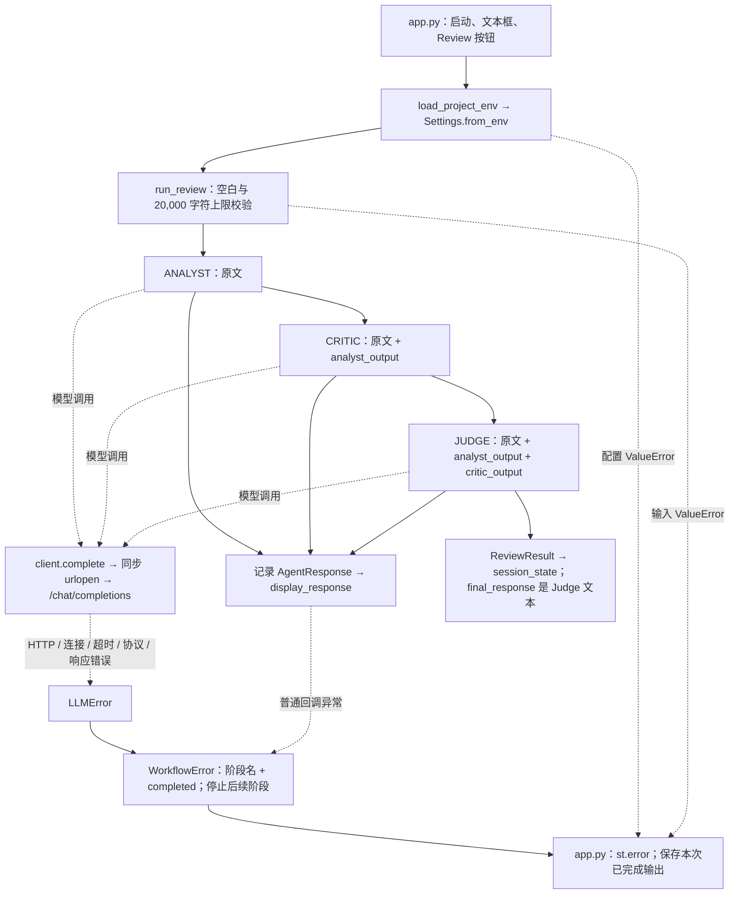

# 第一周工程证据：D1 当前可复用基线

> 历史验收快照：正文的“当前”“下一步”、测试数量与接口描述以本阶段记录时为准。后续变更及现行状态见 [实施总览](implementation-status.md)，运行现有系统请按 [根 README](../README.md)。原命令含教学版本时，不直接覆盖现有源码。

日期：2026-10-13，北京时间。核验开始：20:25。

后续更新：2026-10-16 已完成 [D2 实施](day-02-evidence.md)。本文保留 D1 当时的源码、测试与待办状态，后续能力以实施记录及当前源码为准。

依据：[多 Agent 审核系统｜一周工程计划（2026.10.13—10.19）](https://app.notion.com/p/3f8ff6111f9281b58816c66f7f9b9d18)。本文记录当前仓库证据，不重建规划，不代表后续任务已完成。

## 当前结论与证据边界

- 实际读取了根目录 AGENTS.md、README.md、pyproject.toml、app.py、review_system/ 下六个 Python 文件及 tests/ 下五个测试文件。
- 当前实现是同步 Streamlit → Analyst → Critic → Judge。底层使用 urllib.request.urlopen，无 async/await、线程桥接或 FastAPI 服务入口。
- 今天实际离线测试结果：`60 passed in 1.19s`，退出码 0；失败 0，跳过 0。历史 `28 passed` 不作为本次证据。
- 固定短方案已通过现有 run_review 的三阶段 fake 执行；另用同一输入验证 Critic 失败时停止，保留 Analyst，Judge 不启动。
- Qwen、DeepSeek 的 API Key 在当前进程及项目环境加载后均不可用；live 检查未执行。网络连通性、供应商模型可用性、真实输出质量均未验证。
- 可回退的核心基线提交已确认：`334e3505e93cc60ce6278137aaa28e84875df0f9`，分支 `main`，提交摘要 `chore: capture verified D1 baseline`。用户在原 WSL 完成初始化与提交，工具随后也已读取相同 HEAD 和状态。
- **D1 工程验收完成**：实际文件读取、离线测试、调用链/错误出口、fake 样例、D2—D7 状态及可回退核心基线都有证据。live 因凭据缺失未执行，按计划登记，不阻塞 D1。个人能否独立解释/修改仍由用户确认，不能用本次自动核验替代。

## 今天的最小检查顺序与实际命令

在 `/home/fanli/ai-engineering/multi-agent/mvp` 内执行：

1. 查看版本与工作区，保留已有工作。起初 Git 尚不可用；用户随后建立本地仓库并提交，`git rev-parse HEAD` 确认为 `334e3505e93cc60ce6278137aaa28e84875df0f9`，`git status --short --branch` 显示 `main` 及三个未跟踪的课程资料条目。更新本记录前，`git diff --name-only` 和 `git diff --cached --name-only` 均为空。
2. 读取实际说明、入口、配置、角色、客户端、工作流和全部五个测试文件，确认 imports、fixture、Mock 和 transport 的行为；先判定联网边界，再执行测试。
3. 使用现有虚拟环境运行离线测试：

   ```bash
   .venv/bin/python -m pytest -q -ra --basetemp=.tmp/d1-pytest-20261013-2026
   ```

   首次实际摘要：`60 passed in 1.19s`，退出码 0。新增文档与样例后，以 `.venv/bin/python -m pytest -q -ra --basetemp=.tmp/d1-pytest-after-docs-20261013` 复验，结果为 `60 passed in 0.86s`，退出码 0；两次均失败 0、跳过 0。basetemp 位于 mvp 内。再次复现时可换用新的临时子目录；pytest 会清理指定的 basetemp。

4. 加载项目环境并执行 Settings.from_env，仅输出非敏感配置与密钥是否存在。实际结果：`CONFIG_STATUS=unavailable`、`Set QWEN_API_KEY before running a review.`；QWEN/DEEPSEEK Key 可用性均为 false，不执行 live 调用。
5. 用固定输入进行 fake 正常路径和 Critic 失败路径观察，保存输入、实际调用次数、上下文与输出。
6. 写本记录和固定样例；不改变业务代码，不创建数据库、Docker、API 或新的规划材料。用户已完成核心基线提交；本记录随后补上真实提交与工程验收结果。

运行环境：Python 3.12.3；现有 `.venv` 中 pytest 9.1.1、Streamlit 1.65.0、python-dotenv 1.2.4。pyproject 要求 Python >=3.12，运行依赖为 Streamlit 和 python-dotenv，测试依赖为 pytest；没有 FastAPI、HTTPX、Ruff 配置或依赖锁文件。这里记录当前环境，不声称已完成干净环境安装复现。

## 离线测试与联网验证

| 集合 | 隔离方式 | 今天的证据 |
| --- | --- | --- |
| tests/test_workflow.py | Mock 客户端；协议故障用 patch 替换 clients.urlopen | 角色顺序、不同提示词、原文和前序输出、输入长度、失败即停止、已完成结果、回调失败及 KeyboardInterrupt 传播 |
| tests/test_clients.py | patch clients.urlopen；BytesIO/异常模拟；重定向处理函数本地调用 | HTTP 请求构造、响应提取、401/429/503、连接错误、socket 超时、断流、格式错误和认证头重定向行为 |
| tests/test_config.py | patch.dict 隔离环境，使用合成占位值 | 两供应商默认配置、模型覆盖、超时和无效配置；默认值测试不证明 live 模型可用 |
| tests/test_environment.py | mock load_dotenv 或使用 pytest 临时目录中的合成 .env | 项目根目录加载、环境变量优先、缺失文件、启动顺序；不读取实际 .env 内容 |
| tests/test_app.py | Streamlit AppTest；mock 环境加载，patch clients.urlopen | 三阶段显示、第二次审核失败后清除旧结果并保留本次部分输出、rerun 不重复请求、回调错误恢复 |
| live 检查 | 当前没有专用 live 测试或 live marker | 缺少可用凭据，未执行；不能计入成功或测试跳过数 |

pyproject 的默认 `testpaths = ["tests"]`，上述五个文件全部经过读取并确认模型调用被隔离。docs 中的教学例子不属于本次默认 pytest 集合。AppTest 是离线 UI 行为证据，真实浏览器启动和 UI → API → 模型端到端仍未验证。

## 真实调用链和错误出口



| 位置 | 具体职责和现状 |
| --- | --- |
| app.py:11、28、32、34、42、46 | 启动加载环境；按钮触发配置与工作流；捕获 WorkflowError/ValueError；保存 session_state 并展示错误 |
| app.py:22、39、49 | display_response 显示每阶段；on_response 即时展示；后续 rerun 从 session_state 恢复结果 |
| review_system/agents.py:12、18、24 | ANALYST、CRITIC、JUDGE 三个独立 Agent/系统提示词定义。共同由 run_review 循环执行，没有三个单独的角色执行函数 |
| review_system/workflow.py:37、52、53、59、62、70 | run_review 编排；JSON 上下文；调用 complete；模型失败和回调失败出口 |
| review_system/clients.py:24、34、40–54 | complete 构造 POST；urlopen 阻塞调用，stream=False；异常归一为 LLMError |
| review_system/config.py:21 | Settings.from_env 配置供应商、端点、密钥、角色模型和 socket timeout |
| review_system/environment.py:11 | load_project_env 读取指定项目 .env，保留已存在的环境变量 |

注意这些边界：

- AgentResponse 和 ReviewResult 是保存角色名/模型名/字符串的 dataclass。JSON 用于传递上下文；没有 ReviewRequest/Finding/FinalReview/ReviewRecord 的字段、枚举和摘录位置校验。
- HTTPError、TimeoutError、URLError、无效响应、OSError、HTTPException 都在客户端转为 LLMError；工作流只按客户端协议捕获 LLMError，保留前序输出并停止。用户界面不显示供应商响应正文。
- 回调失败发生在本阶段输出记录后，普通异常转换为 WorkflowError，保留当前输出；KeyboardInterrupt 等 BaseException 继续传播。已有测试证明这一点，但不能用它证明异步任务取消清理。
- REVIEW_TIMEOUT_SECONDS 默认 60 秒，属于 socket 阻塞操作超时；没有全审核总期限。三次角色调用无自动重试；一次成功审核发出三次请求。
- 每次点击创建一个 OpenAICompatibleClient，同一次审核由三个角色复用该对象；没有应用级异步连接池生命周期或共享容量管理。
- UI 当前直接导入配置、客户端与工作流，并在进程中读取模型凭据。尚未走计划要求的 HTTP 后端边界。

## 固定样例与本次 fake 可观察结果

输入文件：[samples/d1-logic-proposal.txt](samples/d1-logic-proposal.txt)。样例是虚构短方案，不代表仓库已有并发上限或历史恢复功能。

运行方式：直接调用现有 run_review，以 Mock.complete 预置三份文本。文本由核验者设定，不是模型生成；只证明执行顺序、上下文和错误传播，不能评价审核质量。没有把 fake 模式接入产品 UI。

实际成功路径：调用数 3；按 Analyst、Critic、Judge 顺序返回。三个阶段的上下文键分别为：

```text
Analyst: original_input
Critic:  original_input, analyst_output
Judge:   original_input, analyst_output, critic_output
```

实际返回内容与模型标识：

| 阶段 | 模型标识 | 返回文本 |
| --- | --- | --- |
| Analyst | fake-analyst | FAKE Analyst：方案使用内存保存记录，声称重启后保留历史，并把本地超时视为供应商停止处理。 |
| Critic | fake-critic | FAKE Critic：内存记录不能保证跨重启恢复；本地超时不能证明供应商停止处理或计费。并发上限需要实现与测试。 |
| Judge | fake-judge | FAKE Judge：删除两项未获证据支持的保证，明确历史恢复、供应商取消和并发隔离仍待验证。 |

最终文本为上述 Judge 文本。完整原文与前序文本传递经过断言核对，退出码 0。

受控故障的实际结果：同一输入、Analyst 成功后让 Critic 抛出 LLMError。调用数 2，completed_agents 为 `["Analyst"]`，Judge 未启动，错误为 `Critic failed: Provider request timed out.`。这是 fake 故障观察，不是实际供应商超时，也不新增历史 bug 记录。

可重复执行的观察命令（不加载 .env、不调用网络）：

```bash
.venv/bin/python - <<'PY'
from dataclasses import asdict
from pathlib import Path
from unittest.mock import Mock
import json
from review_system.clients import LLMError
from review_system.workflow import WorkflowError, run_review

sample = Path('docs/samples/d1-logic-proposal.txt').read_text(encoding='utf-8').strip()
models = dict(analyst_model='fake-analyst', critic_model='fake-critic', judge_model='fake-judge')
replies = [
    'FAKE Analyst：方案使用内存保存记录，声称重启后保留历史，并把本地超时视为供应商停止处理。',
    'FAKE Critic：内存记录不能保证跨重启恢复；本地超时不能证明供应商停止处理或计费。并发上限需要实现与测试。',
    'FAKE Judge：删除两项未获证据支持的保证，明确历史恢复、供应商取消和并发隔离仍待验证。',
]
client = Mock()
client.complete.side_effect = replies
result = run_review(sample, client, **models)
contexts = [json.loads(call.kwargs['messages'][1]['content']) for call in client.complete.call_args_list]
assert [r.agent for r in result.responses] == ['Analyst', 'Critic', 'Judge']
assert contexts == [
    {'original_input': sample},
    {'original_input': sample, 'analyst_output': replies[0]},
    {'original_input': sample, 'analyst_output': replies[0], 'critic_output': replies[1]},
]
print(json.dumps({'mode': 'fake', 'output_origin': 'predefined fixtures, not model output', 'calls': client.complete.call_count, 'context_keys': [list(c) for c in contexts], 'responses': [asdict(r) for r in result.responses], 'final_response': result.final_response}, ensure_ascii=False, indent=2))
client = Mock()
client.complete.side_effect = [replies[0], LLMError('Provider request timed out.')]
try:
    run_review(sample, client, **models)
except WorkflowError as exc:
    assert exc.agent == 'Critic'
    assert client.complete.call_count == 2
    assert [r.agent for r in exc.completed] == ['Analyst']
    print(json.dumps({'mode': 'fake', 'scenario': 'critic_timeout', 'failed_stage': exc.agent, 'calls': client.complete.call_count, 'completed_agents': [r.agent for r in exc.completed], 'error': str(exc), 'judge_started': False}, ensure_ascii=False, indent=2))
else:
    raise AssertionError('Expected WorkflowError')
PY
```

## D2—D7 当前工程状态

分类按整日验收判断；某些子项已通过，不代表整日完成。当前没有一个完整日任务达到“已具备且有证据”，也没有证据支持把整个日任务归为“只缺验证”。

| 日任务 | 当前分类 | 可复用的真实证据 | 仍缺的实现/验证 |
| --- | --- | --- | --- |
| D2 数据契约 | 需要实现 | 三角色独立提示词、JSON 上下文、原文/前序输出、输入界限、LLMError 失败停止；test_order_context_prompts_and_final_response、test_failure_stops_workflow_and_preserves_completed_outputs 等已通过 | 请求和报告 Schema、字段/枚举/摘录校验、阶段状态、logic/evidence 边界；非空任意文本仍可被当作最终输出 |
| D3 真正异步与停止 | 需要实现 | 同步 socket 超时、断流归一、停止后续阶段、回调 KeyboardInterrupt 传播已测 | 异步网络 I/O、两审核并发与隔离、单模型/总期限区分、取消等待清理、共享客户端生命周期与资源恢复 |
| D4 FastAPI | 需要实现 | workflow 与客户端协议分离，可作为服务内核 | ReviewService、GET /healthz、POST /api/v1/reviews、201/422/502/504/409/429 映射、容量和生命周期/API 测试；本仓库未发现对应模块 |
| D5 UI 与真实调用 | 需要实现；live 受凭据阻塞 | Streamlit 入口、逐阶段显示、部分失败/回调失败保留结果、rerun 不重复请求已通过 AppTest | UI 改为只调用后端、协调总预算与重复提交控制、产品 fake 标识、真实 UI → API → 三阶段记录 |
| D6 自动回归 | 需要实现；部分基础已验证 | 默认 tests/ 中 60 个离线用例通过，现有 workflow/config/client/environment/UI 测试可复用 | 契约/异步/API 行为回归、统一静态检查、CI 配置和远程运行、review_id/stage/status/elapsed_ms/error_code 日志；未发现 CI/静态工具配置 |
| D7 干净环境复现与演示 | 需要实现；Docker 范围受当前约束限制 | README 提供 venv 安装和 Streamlit 启动命令；现有 Python 3.12 虚拟环境可运行测试 | 干净环境安装与启动、fake 可复现演示、live 记录、重启验证、精确依赖；当前不存在容器文件。AGENTS.md 明确暂不引入 Docker，本次不创建，后续范围需对齐 |

## 基线文件指纹与实际版本证据

以下 SHA-256 用来识别 D1 核验时的代码/说明/测试内容，不包含 .env 或密钥。它们已与核心基线提交中的文件核对；可回退版本为 `334e3505e93cc60ce6278137aaa28e84875df0f9`。后续仓库整理会更新 README 和忽略规则；这些指纹仍表示该历史基线，并非后续所有文件的最新值。

```text
412f60c995d017ef619edee28f54ebcf8b868e847f320e43be2d1a3e137932e4  AGENTS.md
b80477b0a589b78b9a0d0335316f17a027acd1f043d49f3a9bf458cbe24cb251  README.md
de72a0d0f00b09363ac8b2d4bd7533456921957aff429e0a20fd0e2ddeccb7a3  pyproject.toml
de7403a66fa7ccef383659360f69e95c4617b52cafca94b6df5b16b1e7542f32  app.py
8a47e27c9d879c9a8175564d8386e82d0b165828c0ea93053cc7a907565b3fac  review_system/__init__.py
1e5937f3857a75ae0439092ce97734c2c55e61b8dd35d0fded92467b4abe14ea  review_system/agents.py
ee6b71c066e98d00955403ccbc76ffbee5b442be8f5343e463d9b81fbcbc2a19  review_system/clients.py
5fccaeaf819d6d6b523babf32e3f10735bbc52dcc17d7a7ea0c2a389da488f5b  review_system/config.py
4beaed16cea38f714ef013b08cd0e15cc3b917913c621364f2b914768b670572  review_system/environment.py
b3123338424b73774a2bf0ab83e399b8839bc1a62d7d196ccc1c7970ed9c6f2e  review_system/workflow.py
c772a3b463fb488413c1aa73805ee4587601c03b96a850af9b5e2b6f0f25a873  tests/test_app.py
713e0729d0122d9301db31e33cb9d4cff349dcee9207284389ea96f765857b93  tests/test_clients.py
b7901f09bfd45b5481e6fde323b7fb7a91f5dfd2c4253c52a58c5836c670f1a0  tests/test_config.py
55fa8274eda29172a586296a579057a7446aa1047d67076843e6fe89d51d439e  tests/test_environment.py
efbdbe5a13d470200c1d49d3c483dae232106129bbec86d61be4c457dfeb3085  tests/test_workflow.py
```

用户在原 WSL 完成的实际结果：

- 初始化本地仓库，分支 `main`；在仓库本地配置 Git 作者身份。
- 根提交：`334e3505e93cc60ce6278137aaa28e84875df0f9`。
- 摘要：`chore: capture verified D1 baseline`。
- 提交范围：19 个文件，1098 行新增；包括核心源码、全部五个原测试文件、AGENTS/README/pyproject、.gitignore、无凭据 .env.example、本记录的初版及固定样例。
- 实际 `git status` 仅留下以下未跟踪的既有课程资料：`docs/Multi-Agent_MVP_软件架构与Python源码精读_两小时课程.docx`、`docs/two-hour-course/`、`docs/从零手撕多智能体审查项目.md`。核心基线已提交，整个目录仍有未跟踪文件，不能称为完全干净的工作区。
- 本次基线版本未收录上述课程资料，因此回退到该提交只保证核心实现、测试、基线说明及样例。README 中课程链接依赖这些本地资料，不属于已经验证的干净检出复现能力；D7 需处理文档交付范围。
- 实际 .env、虚拟环境和测试缓存未进入提交。未推送远程。

初次 Git 不可用及首次提交缺少作者身份的问题已由上述初始化、本地配置和实际提交解除；不把它们登记为业务代码故障。

## 当天记录

- 实际改动：新增本记录及 docs/samples/d1-logic-proposal.txt；业务代码、原测试、README 和依赖配置保持本次读取时的内容。
- 实际基线提交：`334e3505e93cc60ce6278137aaa28e84875df0f9`；当前记录补充该提交后的闭环结果，核心源码与测试仍以该提交为基线。
- 当前原有失败：离线测试中没有失败；live 凭据不可用仍是核验限制，不混入 pytest 失败/跳过计数。Git 版本证据已补齐。
- 本次引入失败：没有观察到；新增文档与样例后复验为 `60 passed in 0.86s`，退出码 0。15 个原始说明、代码与测试文件的 SHA-256 均与首次读取一致。
- 我能独立解释或修改的部分：待用户确认。建议沿 app.py:34 → workflow.py:59 → clients.py:34 解释一次输入，并说明 Critic 为什么包含 analyst_output、Critic 失败后为什么 Judge 不启动。
- 下一步：D1 工程验收已完成；下一项为 D2 的请求/输出契约最小增量，复用已有顺序与失败传播测试。个人掌握程度单独确认。

## D1 后的仓库整理

2026-10-13，按用户要求整理为适合 Git 交付的完整项目：

- 根 README 改为中文项目入口，提供安装、默认离线测试、fake 教学演示、模型配置、UI 启动、目录与能力边界。
- 新增 docs/README.md 文档索引；将既有中文教程、Markdown/Word 课程及 11 个课堂示例纳入版本管理。上节“课程资料未跟踪”记录的是核心基线提交时的状态；后续整理提交将包含这些资料。
- 修正教程指向仓库外的练习链接；把课程示例中的本机路径改为 `/path/to/mvp`，Word 课程中的同一命令同步更新。
- 扩充 .gitignore，排除 Python 缓存、虚拟环境、临时与构建产物；新增 .gitattributes，统一文本换行并将 docx 标为二进制。
- 实际验证：默认应用测试命令 `.venv/bin/python -m pytest -q -ra --basetemp=.tmp/git-preparation-pytest` 返回 `60 passed in 1.48s`；显式运行三个课堂测试文件返回 `7 passed in 0.11s`，两次退出码均为 0。E05/E06 fake 演示均成功，31 个 Markdown 本地链接已检查；Word 的 ZIP/XML 结构校验通过，.env.example 两个密钥字段为空，凭据/缓存/环境/构建忽略规则有效。
- 该整理不实现 D2—D7 的业务功能。D1 的代码、测试及可回退版本仍以 334e350 为证据；应用源码、原测试和依赖配置保持不变。当前未配置远程地址，本次交付为本地完整仓库。
